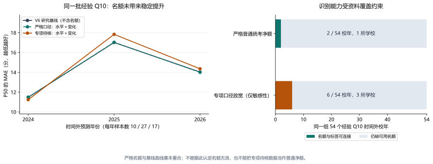

# 报名截止前可见净名额的研究性回测

结论：当年名额已作为研究变量接入，但当前资料未提供足以替换正式模型的预测增益。正式模型、2027 冻结预测、网页与论文数值不变。

## 1. 数据接入结果

使用已发布的 `data-quota-20261023-r2` 固定快照，对全部 436 条记录逐条作两套适用性判断，形成 872 行审计台账。

- 严格普通净额：7 个校年满足来源/时点/普通专项口径，其中中央财经大学 2022—2027 的 6 个可连接现有院校标签；厦门大学 2027 的单学院名额不能强接到多学院学校标签。历史可连接值为 5 个校年。
- 专项未清敏感性：27 条原文已核记录、24 个校年；显式单位连接后为 4 校 17 个校年，其中历史为 13 个。不能将这批值称为已核定普通统考净额。
- 在 2024—2026 的 226 个可评价校年内，严格名额仅覆盖中央财经大学 3 条：其中 2024 是代理，2025/2026 是审计通过经验 Q10。因此主比较真正有严格名额的只有 2/54、1 所学校。敏感性主比较覆盖 6/54、3 所学校。
- 其余已审计数据仍参与模型训练、代理误差估计或单独评分；349 条规则候选、未知发布日期、截止后修订附件和单位口径不明的记录保留排除理由，不因想扩大样本而补零或放行。

培养单位连接采用显式同义映射；南京大学旧称数学系、新称数学学院，西南财经大学旧称统计学院、新称统计与数据科学学院。未核清学校级多学院标签前，不汇总不同学院名额。未取得当年网页存档的历史记录仍只是现存官方公告日期下的回溯重建，不是完整的历史资料版本。

## 2. 实验方法

以 V6 观测误差随机截距作为研究基线。每个原点仅使用此前标签，优先使用经验 Q10，同校年的代理不重复入模；观测误差参数、REML 方差、特征中心均在训练窗重估。当年特征仅依赖该年报名截止前可见的官方剩余净额或同范围总计划减实际接收推免，绝不采用最终录取人数、拟推免人数或上一年名额代替。

名额以 log2 水平和相邻年 log2 比值进入正则化协变量；缺失值保持 NaN，设计矩阵零代表不添加数量调整，并另有可得性标记。零均值系数先验在 `X D Xᵀ` 中一次性积分，系数与截距不确定性进入预测，方差超参数仍为经验贝叶斯插件估计。数量系数标准差固定 10 分/翻倍，另作 5/20 敏感性；标记标准差固定 5 分，不根据本轮外层结果选模型或继续调参。

两种资料口径分别比较仅可得性、仅水平、仅变化、水平加变化，加上两种先验敏感性，共 12 个候选；另有共同基线。3 个原点完成 36 次候选拟合。该设计是已知旧结果后的回溯比较，不称预注册或盲测。

## 3. 同一组 54 个经验 Q10 校年的主结果

| 模型 | MAE（分） | WIS ↓ | P90 覆盖 | 平均 P90−P50 |
| --- | ---: | ---: | ---: | ---: |
| V6 研究基线（不含名额） | 15.050 | 8.799 | 92.6% | 23.22 |
| 严格口径：仅可得性标记 | 15.053 | 8.804 | 92.6% | 23.23 |
| 严格口径：名额水平 | 15.051 | 8.803 | 92.6% | 23.23 |
| 严格口径：名额变化 | 15.053 | 8.804 | 92.6% | 23.23 |
| 严格口径：水平＋变化 | 15.051 | 8.803 | 92.6% | 23.23 |
| 专项待核：仅可得性标记 | 15.077 | 8.799 | 92.6% | 23.25 |
| 专项待核：名额水平 | 15.280 | 8.909 | 92.6% | 23.42 |
| 专项待核：名额变化 | 15.360 | 8.943 | 92.6% | 23.32 |
| 专项待核：水平＋变化 | 15.519 | 9.038 | 92.6% | 23.49 |

这里的基线是论文中的 V6 研究候选，不是网页当前冻结正式预测。冻结正式模型在同一 54 条上的 MAE=15.83、WIS=10.77；V5 增强为 14.90、10.81。不能把新名额候选与较弱旧模型比较后，把 V6 本身的改进全部记为名额贡献。

预设严格口径全特征相对基线的 MAE 差为 +0.0007 分，WIS 差为 +0.0036；实际可用性上基本没有变化。专项口径放宽后的全特征 MAE 恶化 0.47 分，WIS 恶化 0.24。

所有候选的总体 P90 覆盖都为 50/54，2026 仍只有 14/17；区间没有变成更可靠的 90% 保证。覆盖率相同并不表示分布一样，应同时比较 WIS、pinball 和宽度。



图读取本轮模型输出：左图显示三年误差及严格口径几乎重合的曲线，右图显示精确标签与净名额的真实交集。

## 4. 有名额的子集与先验敏感性

| 名额覆盖子集 | 校年/学校 | 基线 MAE | 加名额 MAE | 基线 WIS | 加名额 WIS |
| --- | ---: | ---: | ---: | ---: | ---: |
| 严格普通净额 | 2/1 | 22.02 | 22.16 | 12.94 | 13.10 |
| 专项待核敏感性 | 6/3 | 17.68 | 21.95 | 11.16 | 13.34 |

严格子集只有中财 2025/2026 两次，不能计算有全国泛化含义的学校簇置信区间。专项待核子集的学校簇与年份整块重抽结果保留在 `paired_uncertainty.json`，仅描述现有组合；只有三个日历年，不将 54 校年当作 54 次独立年份冲击。

| 资料口径 | 系数先验标准差 | MAE | WIS |
| --- | ---: | ---: | ---: |
| 严格普通净额 | 5 | 15.0525 | 8.8040 |
| 严格普通净额 | 10 | 15.0510 | 8.8028 |
| 严格普通净额 | 20 | 15.0455 | 8.7984 |
| 专项待核 | 5 | 15.2763 | 8.9016 |
| 专项待核 | 10 | 15.5192 | 9.0376 |
| 专项待核 | 20 | 15.7848 | 9.1924 |

严格口径在放宽先验至 20 时有约 0.005 分的微小 MAE 下降，不作为有效改进、不据此改选 20。它小于可支持的实用差异，且仅一校可识别。专项待核口径随正则化减弱而变差，提示在当前小样本下放大数量系数会增加过拟合风险；这不是名额变量在更完整数据上无效的证据。

## 5. 暂不晋级与后续补数顺序

所有候选均未达到预设的至少 20 个名额覆盖精确时间外校年、5 校、2 年和 10% 覆盖的最低独立性护栏；默认全特征也未实现至少 2% 的 WIS 改善。结论是**当前证据不足、先保留研究模块**，而不是删除名额变量，也不是宣布名额无效。正式模型不替换，网页和毕业论文的正式数值不追认这些候选。

下一步优先补能扩大独立识别的信息：

1. 先补有逐人经验 Q10 的学校同年名额，尤其上海交大、南京大学的专项扣除明细；这比随机新增无法和标签连接的名额更有效。
2. 对多学院学校恢复学院级名单标签，再连接各自计划、实际推免与专项，不强行求和投到学校最高门槛。
3. 恢复较早年份的官方附件和版本日期，使同校名额变动有更多时间点，并保留计划到最终人数的历史修订作为另一变量。
4. 数据覆盖足够后再评估同校内名额变化、学校间规模与事件交互；仅有单校时不估全国扩缩招弹性，不通过换复杂模型掩盖不可识别。

## 6. 复现与核验

全部数据为公开校年聚合，不读取逐人私有名单。回测保留全部 226 个可评价校年（54 个经验 Q10、172 个代理）的同一原点预测，每个模型单独评分；代理改善不冒充经验 Q10 改善。77 个已审计分布在各训练原点前按时间使用，不为了扩大测试量把训练年份算作测试。

```powershell
python -m pip install -r model/requirements-deadline-quota.txt
python -m unittest discover -s model -v
python model/experiment_deadline_quota.py
python model/verify_deadline_quota_experiment.py
python model/report_deadline_quota.py
python model/verify_frozen_forecast_outputs.py
```

本次实际环境：Python 3.13.5，numpy 2.5.3，pandas 2.2.3，scipy 1.18.1，scikit-learn 1.6.1。统计主计算无随机抽样，整簇重抽种子为 20261024；依赖版本单独锁定，不改原生产依赖。

核验结果：138 项结果/时点/哈希检查通过；36 个候选拟合全部收敛。独立沿用旧 V6 评分函数重算 MAE/WIS。既有 V6 三原点所有分位复现最大差小于 1e-4，实际最大约 5.7e-14。十个正式冻结数值文件哈希全部不变。模型目录 35 项测试通过，其中本轮新增 20 项，覆盖截止时钟、组件后修订、实际与拟推免区分、缺失保留、单位错配、未来隔离和基线等价。

输入路径、SHA256、运行环境和基础提交见 `summary.json`；同时保存原字节和统一 LF 后的文本哈希，以识别 Git 在 Windows/Linux 检出时的纯换行差别，原始官方证据文件哈希不作该转换。每个原点的系数后验、方差和训练覆盖见 `origin_fits.json`。系数为正则化预测关联，不是因果效应。源证据 URL 和定位见 `record_eligibility.csv`；原记录的生产准入标记保持不变。

完整方案见 [回测方案](../../../docs/deadline_quota_backtest_protocol_20261024.md)，基础资料口径见 [R2 数据审计](../../../docs/quota_deadline_collection_20261023_r2.md)。
